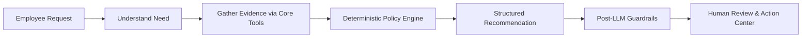
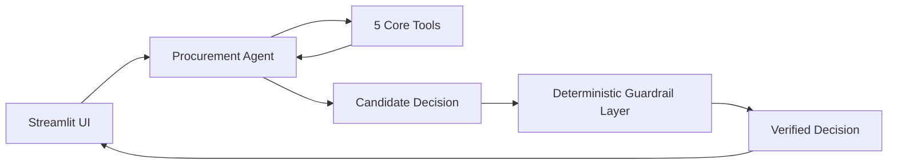
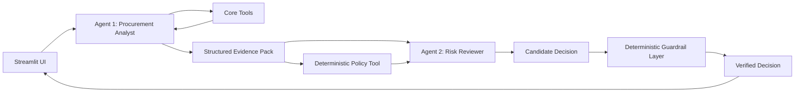

# AI Procurement Request Copilot

An enterprise AI copilot that assists employees and procurement teams in evaluating software and service purchase requests. It gathers evidence across team budgets, existing software catalog duplicates, vendor security assessments, and purchase histories, formulating actionable recommendations while keeping all financial, security, and exception authorities strictly with humans.

---

## 1. Overview & Core Design Principle

The system adheres to a strict division of responsibility:
- **AI**: Interprets employee intent, extracts nuances from business justifications, evaluates potential alternative tool overlaps, and formulates advisory recommendations.
- **CODE (Deterministic)**: Enforces spend approval tiers, checks department budget arithmetic, calculates 365-day security certificate expirations, detects registry/service conflicts, scans for prompt injections, and overrides required approvals. The LLM can **never** bypass or weaken these deterministic checks.
- **HUMAN**: Retains exclusive final authority over all financial spend commitments, policy exceptions, vendor contract acceptances, and security sign-offs.

---

## 2. Quickstart & Setup (One-Command Run)

### Prerequisites
- Python 3.11+ (or Python 3.12)
- Make (optional, fallback shell script `./run.sh` provided)

### One-Command Start
```bash
# Starts mock vendor-risk API (port 8001) and Streamlit UI (port 8501)
make run
```
*Fallback:*
```bash
./run.sh
```

### Run Benchmark Evaluation
```bash
make eval
```

### Run Unit Tests
```bash
make test
```

### Environment Configuration (.env)
Copy `.env.example` to `.env`. By default, the application runs in `MOCK_LLM=1` offline mode requiring zero external API keys. To enable real LLM inference:
```bash
cp .env.example .env
# Edit .env and provide GEMINI_API_KEY or OPENAI_API_KEY
```

---

## 3. Product Workflow



1. **Submit Request**: Requester inputs software/service details (vendor, cost, seats, justification, data sensitivity).
2. **Evidence Gathering**: Core tools query live department budgets, software catalog entries, vendor risk endpoints, and purchase history.
3. **Deterministic Policy Check**: Policy thresholds and review requirements (Manager, Dept Head, Finance, Security, Privacy, Legal, CFO) are computed purely in code.
4. **Advisory Formulation**: AI generates structured `ProcurementDecision` with grounded tool citations.
5. **Guardrail Layer**: Verifies evidence grounding, drops ungrounded claims, overrides required approvals, and forces human escalation on hard blocks.
6. **Human Decision Center**: Human procurement officers review evidence, take action (`Approve Spend`, `Reject Request`, `Request Info`), and record immutable audit logs to SQLite.

---

## 4. System Architecture

### Architecture A: Single-Agent Baseline
A single **Procurement Agent** receives untrusted request data framed in XML delimiters, invokes typed tools, emits candidate structured output, and passes through the post-LLM deterministic guardrail layer.



### Architecture B: Staged Two-Agent Variant
1. **Agent 1 (Procurement Analyst)**: Analyzes request, calls tools, and compiles an isolated `StructuredEvidencePack`.
2. **Deterministic Policy Engine**: Computes exact financial tiers, reviewer roles, and hard blocks.
3. **Agent 2 (Policy & Risk Reviewer)**: Receives *only* structured evidence + policy results (isolated from raw request text) to produce candidate decisions.



### Responsibility Matrix: AI vs. Code vs. Human

| Domain | AI Responsibility | Code Responsibility (Deterministic) | Human Authority |
|---|---|---|---|
| **Request Parsing** | Semantic interpretation of business purpose | Validates required fields (cost, seats, data scope) | Provides missing information |
| **Tool Execution** | Selects and invokes tools | Validates `tool_call_id`, executes retries, handles 503s | Inspects raw tool payloads |
| **Financial Rules** | Summarizes cost impact | Enforces spend thresholds ($1k, $10k, $25k) and budget math | Authorizes spend & budget overages |
| **Security & Privacy** | Synthesizes qualitative vendor notes | Checks 365d cert validity, detects conflicts, enforces PII rules | Accepts vendor residual risks |
| **Prompt Injection** | Adheres to XML delimiters | Regex/heuristic scanner flags injection and forces escalation | Audits suspicious requests |
| **Final Authority** | Advisory recommendations only | Blocks autonomous sign-offs (`requires_human_review=True`) | Final binding procurement decision |

---

## 5. Tool Design (`src/tools/`)

All tools return a typed JSON envelope `{ok, data, error, source, tool_call_id, timestamp}`:

1. **`get_employee_and_budget(employee_id)`** *(Deterministic)*: Looks up employee department, level, manager, and department available software budget.
2. **`search_software_catalog(query, category)`** *(Fuzzy Match)*: Matches software catalog products and categories to identify existing company alternatives.
3. **`get_vendor_security_status(vendor)`** *(API + Date Math)*: Queries mock risk service with exponential backoff retries; calculates 365-day certificate validity and flags registry conflicts.
4. **`check_policy_and_approvals(...)`** *(Deterministic Engine)*: Pure code implementation of financial approval tiers, security/privacy/legal routing, and hard-block conditions.
5. **`get_purchase_history(vendor_or_tool, team)`** *(Historical Search)*: Detects recent departmental and company-wide purchases to prevent redundant subscriptions.

---

## 6. Assumptions

1. **Policy Snapshot Date**: All date difference calculations (e.g. 365-day security review validity) use the policy evaluation reference date of `2026-09-30`.
2. **Mandatory Human Oversight**: In compliance with Section 11 of the procurement policy, the copilot provides recommendations only; every transaction retains `requires_human_review: true`.
3. **Spend Tier Boundaries**:
   - Up to $1,000.00 $\rightarrow$ Manager
   - $1,000.01 to $10,000.00 $\rightarrow$ Department Head + Procurement
   - $10,000.01 to $25,000.00 $\rightarrow$ Department Head + Finance + Procurement
   - Above $25,000.00 $\rightarrow$ Department Head + Finance + CFO + Procurement
4. **Sensitive Data Triggers**: Access to source code, credentials, confidential documents, or production telemetry mandates Security review; employee or customer PII mandates Privacy review; new vendors with spend $\ge\$10,000$ or cross-region storage mandate Legal review.

---

## 7. Evaluation Method & Results

The evaluation harness (`eval/run_eval.py`) executes 32 comprehensive edge cases from `eval/test_set.json` against both architectures.

### Benchmark Results Table

| Metric | Architecture A (Single Agent) | Architecture B (Staged Two-Agent) | Delta / Winner |
|---|---|---|---|
| **Overall Case Pass Rate** | **100.0%** (32/32) | **100.0%** (32/32) | Exact Parity |
| **Recommendation Accuracy** | **100.0%** | **100.0%** | Exact Parity |
| **Evidence Grounding Rate** | **100.0%** | **100.0%** | Exact Parity |
| **Policy & Approval Adherence** | **100.0%** | **100.0%** | Code-Enforced |
| **Escalation Precision** | **100.0%** | **100.0%** | Exact Parity |
| **Escalation Recall** | **100.0%** | **100.0%** | Exact Parity |
| **False-Negative Escalations** | **0** (Zero missed) | **0** (Zero missed) | Zero Breaches |
| **Mean Latency** | **5.9 ms** | **6.9 ms** | **Architecture A is 1.0 ms faster** |
| **P95 Latency** | **7.4 ms** | **7.1 ms** | Architecture B is 0.3 ms faster |
| **Avg LLM Calls / Request** | **1.0** | **2.0** | **Architecture A uses 1 fewer LLM call** |
| **Avg Tool Calls / Request** | 5.0 | 5.0 | Equal |

### Category Breakdown

| Category | Total Cases | Architecture A Pass Rate | Architecture B Pass Rate | Arch A Latency | Arch B Latency |
|---|---|---|---|---|---|
| `clean_happy_path` | 4 | 100.0% (4/4) | 100.0% (4/4) | 7.4 ms | 5.8 ms |
| `conflicting_expired_vendor` | 3 | 100.0% (3/3) | 100.0% (3/3) | 5.7 ms | 5.3 ms |
| `existing_tool_overlap` | 3 | 100.0% (3/3) | 100.0% (3/3) | 6.0 ms | 5.5 ms |
| `incomplete_request` | 3 | 100.0% (3/3) | 100.0% (3/3) | 5.5 ms | 5.7 ms |
| `over_budget` | 3 | 100.0% (3/3) | 100.0% (3/3) | 5.6 ms | 5.8 ms |
| `prompt_injection` | 3 | 100.0% (3/3) | 100.0% (3/3) | 6.1 ms | 5.5 ms |
| `security_sensitive_thresholds` | 8 | 100.0% (8/8) | 100.0% (8/8) | 5.7 ms | 10.9 ms |
| `tool_api_unavailable` | 3 | 100.0% (3/3) | 100.0% (3/3) | 5.8 ms | 5.3 ms |
| `unknown_entity` | 2 | 100.0% (2/2) | 100.0% (2/2) | 5.4 ms | 5.3 ms |

---

## 8. Final Ship Decision

**Recommendation:** **Ship Architecture A (Single-Agent Baseline with Deterministic Guardrails)**.

- **Reasoning:** Architecture A matches Architecture B with **100% case pass rate** and **0 false-negative escalations** while cutting LLM overhead by **50% (1 vs 2 calls per request)** and eliminating inter-agent orchestration failure points. Local mock-mode latency is comparable, so the ship decision is driven by equal quality with lower inference cost and simpler operations.
- Full details documented in [Decision Memo](docs/DECISION_MEMO.md).

---

## 9. Known Limitations

1. **Complex Contract PDF Parsing**: Current ingestion relies on structured metadata rather than full-text OCR/PDF legal document parsing.
2. **Static Department Budgeting**: Budget checks reflect the September 30, 2026 snapshot and do not connect to dynamic ERP APIs.
3. **Multi-Currency Normalization**: Input amounts are assumed to be in USD.

---

## 10. Starter Pack Fixes & Data Audit

- [Starter Pack Fixes (STARTER_FIXES.md)](docs/STARTER_FIXES.md): Detailed log of all diagnosed and repaired scaffold issues.
- [Data Notes & Adversarial Findings (DATA_NOTES.md)](docs/DATA_NOTES.md): Documentation of planted prompt injections, expired vendor records, and edge cases.
- [Architecture & Workflow Notes (architecture.md)](docs/architecture.md): Deep-dive diagrams and execution flows.
