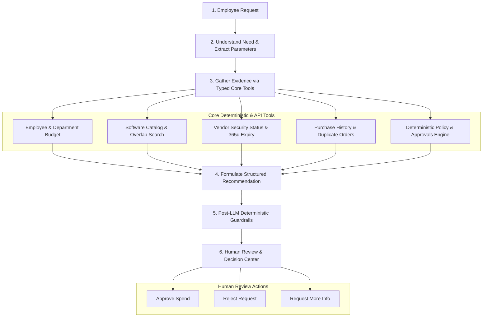
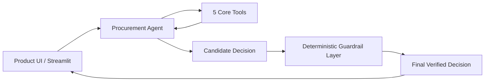
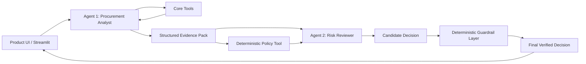

# System Architecture and Workflow Design (docs/architecture.md)

## 1. End-to-End Procurement Workflow

The AI Procurement Request Copilot enforces a strict separation of concerns across AI interpretation, deterministic code verification, and human authority.

---

## 2. Architecture Comparison: Single Agent vs. Staged Two-Agent

### Architecture A: Single-Agent Baseline
In Architecture A, a single **Procurement Agent** receives the untrusted user request, orchestrates tool calling across budget, catalog, vendor security, and history sources, and produces a candidate decision that is passed through the deterministic guardrail layer.

### Architecture B: Staged Two-Agent Variant
In Architecture B, responsibility is split into two specialized stages:
1. **Agent 1 (Procurement Analyst)**: Interprets user request, executes core tools, and compiles an isolated **Structured Evidence Pack**.
2. **Deterministic Policy Engine**: Computes exact financial tiers, required reviewer roles, and hard blocks.
3. **Agent 2 (Policy & Risk Reviewer)**: Receives *only* the structured evidence pack and deterministic policy outputs (isolated from raw prompt text), reasons over trade-offs and catalog overlaps, and emits the candidate decision.

---

## 3. Responsibility Matrix: AI vs. Code vs. Human

| Domain | AI Responsibility | Code Responsibility (Deterministic) | Human Authority |
|---|---|---|---|
| **Request Interpretation** | Understands user context, extracts implicit requirements, evaluates business justifications | Validates presence of mandatory schema fields (cost, seats, data level) | Resolves ambiguity and provides clarifying details |
| **Tool Execution & Grounding** | Selects and invokes appropriate evidence tools | Generates `tool_call_id`, enforces network retries, handles 503 outages | Inspects raw tool payloads and evidence citations |
| **Financial & Policy Thresholds** | Summarizes budgetary context | Computes exact spend tiers ($1k, $10k, $25k), budget arithmetic, and overrides hallucinated roles | Approves expenditure, signs off on budget overages |
| **Security & Privacy Risk** | Synthesizes complex vendor risk notes | Calculates 365-day certificate expiry, detects registry conflicts, enforces PII/cross-region rules | Grants security exceptions and accepts residual vendor risks |
| **Prompt Injection Defense** | Follows XML untrusted boundary guidelines | Heuristic/regex pattern scanner flags injection and forces human escalation | Audits suspicious requests flagged by the system |
| **Final Authority** | Provides structured advisory recommendations only | Hard-blocks autonomous approval and guarantees `requires_human_review=True` | Executes final purchasing, contracts, and vendor commitments |
